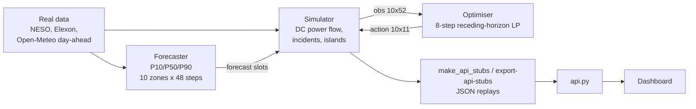

# JMap

**Stress-testing Great Britain's grid in worlds that haven't happened yet.**
Team Solaris · 4 builders · 24 hours · Warwick hackathon, theme *New Worlds*

JMap replays GB demand and weather, injects counterfactual incidents (line trips, plant outages, islanding) and compares how the grid fares with and without an optimising response layer. It combines a probabilistic demand forecaster, a DC power-flow simulator and a receding-horizon linear programme.

## Headline: full B6 (Scotland–England) outage, real windy winter evening (14 Dec 2025, trip at 17:00)

| | No response | Optimiser |
|---|---:|---:|
| Unserved demand | 63,917 MWh | **0 MWh** |
| Operating cost | £388.5M | **£17.4M** |
| Penalties | £205.2M | **£0** |

"No response" is network-blind merit-order dispatch: it schedules plant economically and ignores line limits. Data: NESO + Elexon demand and generation with Open-Meteo day-ahead weather forecasts, 7 Mar 2024 – 31 Dec 2025. Zonal demand is estimated from national data.

| Scenario (real data) | No response: unserved / cost + penalty | Optimiser: unserved / cost + penalty |
|---|---:|---:|
| B6 trip, windy peak (14 Dec 2025) | 63,917 MWh / £593.7M | 0 MWh / £17.4M |
| Cold snap +18% demand (10 Jan 2025) | 10,592 MWh / £139.4M | 3,052 MWh / £96.0M |
| Nuclear outage, low wind (9 Nov 2024) | 0 MWh / £50.0M | 0 MWh / £49.5M |
| Random real days (mean of 8) | 0 MWh / £46.3M, 14,484 MW-steps overload | 0 MWh / £29.8M, 0 overload |

In the cold snap, demand exceeds available capacity, so some shedding is unavoidable; the optimiser sheds the minimum.

## Architecture



Every boundary is fixed by **`schemas.py` (contract v1.1.0)**: zone, edge and fuel ordering, units, shapes and reward. The dashboard consumes JSON replays, so it was built against stubs before the backend existed.

| Contract item | Value |
|---|---|
| Zones / corridors / fuels | 10 / 14 / 8; slack bus MIDL; B6 = `SSCO-NORT` |
| Forecast | `(10, 48, 3)`: P10 / P50 / P90 |
| Observation / action | `(10, 52)` / `(10, 11)`, actions in [−1, 1] |
| Reward | −(operating cost + penalties) / 100,000 per step, in £ |
| Prices | VoLL £6,000/MWh, carbon £67/t, curtailment £70/MWh, DR £300/MWh, overload £1,000/MW per half-hour |

## Forecast accuracy (real data)

Chronological split: train 7 Mar 2024 – 31 Mar 2025, validation Apr – Jun 2025, test Jul – Dec 2025 (8,785 issue times, scored once). Routing chosen on real validation: persistence h1–2, LightGBM h3–48.

| Horizon | Hybrid P50 MAE (MW) | Persistence | Weekly lag |
|---|---:|---:|---:|
| h1 | 36.0 | 36.0 | 201.5 |
| h4 | 80.6 | 94.7 | 201.5 |
| h12 | 106.7 | 184.7 | 201.5 |
| h24 | 114.4 | 212.5 | 201.4 |
| h48 | 112.6 | 206.1 | 201.0 |
| **Overall** | **107.0** | 189.5 | 201.3 |

National-aggregate P50 MAPE: **4.15%** (persistence 7.37%, weekly 7.80%). P10–P90 coverage: **78.7%** (target 80%), with the interval calibration rolling forward causally, using only forecasts whose outcomes are already known (68% with static validation-only calibration).

Walk-forward check (retrain at each origin, score the next two months):

| Retrain | Window | Hybrid MAE (MW) | Persistence MAE (MW) | Issue times |
|---|---|---:|---:|---:|
| 1 Jul 2025 | Jul–Aug | 105.0 | 176.9 | 2,976 |
| 1 Sep 2025 | Sep–Oct | 102.1 | 201.2 | 2,928 |
| 1 Nov 2025 | Nov–Dec | 115.0 | 190.5 | 2,881 |

## Components

**Forecaster.** Each horizon has its own model, chosen by validation MAE: persistence at h1–2, LightGBM quantile boosters beyond. There are two learned candidate families (a residual from last-known demand, and a log correction to persistence), each with three quantile boosters. Features are daily and weekly lags, recent demand, rolling statistics, calendar variables and weather forecast vintages. At issue time `T`, demand is known only through `T − 30 min`. Weather must be a forecast issued no later than `T`. The P10–P90 intervals are recalibrated on a rolling basis using only outcomes that had already happened. The train/validation/test split is chronological, and the test set is scored once.

**Simulator (`grid_env.py`, Gymnasium).** Flow on each corridor is `f = b (θ_i − θ_j)`. Susceptance scales with the fraction of circuits that survive. After a split, each electrical island is solved independently with its own reference angle. The simulator also models storage, curtailment, demand response and spill. Flow factors are cached per topology, and it runs at about 3,900 steps/s. `make_scenario_env(name)` loads `scenarios/*.json`; `date_range=` restricts which episodes it samples.

**Optimiser (`agents_baseline.py`, `OptimiserAgent`, `dc-lp-v2`).** A sparse LP over 8 half-hours, solved with SciPy/HiGHS. It minimises the simulator's own prices: fuel + carbon + DR + curtailment + VoLL × (shed + firm spill), minus a terminal storage credit. Constraints: nodal balance per island, hard limits on surviving corridors, plant availability, bounded demand response and shedding, and battery state of charge, power and efficiency. It re-solves with fixed battery direction if it finds a battery charging and discharging at once. It executes step 1 and replans, at about 13 ms per decision end to end.

**Dashboard (`UI/`).** A buildless JS app with four pages:
- `UI/operations.html`: the simulator. Split-screen replay of no response vs optimiser on each scenario, with a scoreboard, zone shortage markers and corridor loading.
- `UI/generation.html` (also `UI/index.html`): map of every GB generating site from the official DESNZ REPD and DUKES operating-asset registers.
- `UI/transfers.html`: live GB interconnector imports and exports from Elexon FUELINST (needs internet; separate from the simulation).
- `UI/explorer.html`: local-authority energy statistics and an area heatmap.

Detail, data sources and UI regression checks are in [`UI/README.md`](UI/README.md).

## Run it

```sh
pip install numpy scipy pandas pyarrow gymnasium fastapi uvicorn lightgbm   # or use pyproject.toml

# regenerate the dashboard replays from the backend (only needed after backend or data changes)
python -B UI/scripts/export-api-stubs.py --backend-root dhruv_latest

# serve the replays and open the dashboard
uvicorn api:app --port 8000
python -m http.server 8080 --directory UI    # then visit http://localhost:8080/operations.html
```

Backend checks, from `dhruv_latest/`: `python3 schemas.py` (contract self-check) and `python3 scripts/check_parquet.py data/canonical/real.parquet` (data validator).

Tests: `node --test UI/tests/*.test.cjs`, and `python -B UI/tests/api-replay.test.py` with the API running.

**Hosting:** the repo is set up for Vercel (`vercel.json`, root directory `.`); see [`UI/VERCEL.md`](UI/VERCEL.md).

## Repository layout

```
dhruv_latest/          backend: schemas.py, grid_env.py, agents_baseline.py, scenarios/, scripts/, data/
UI/                    dashboard, exporter scripts, tests
api.py                 FastAPI server for the dashboard replays
stubs/                 generated replays served to the dashboard
```

## What we tried and cut

Residual PPO on top of the LP: 100k steps, 20 paired seeds. It won 0/20, with mean reward −365.43 vs −361.43 for the LP, and mean unserved energy 43.46 vs 0.003 MWh. The LP's balance is exact, so learned corrections only break it. The shipped response layer is the LP.

## Limits

This is a lossless 10-zone DC approximation: no AC voltage, reactive power, losses or stability. Zonal demand is estimated from national data. The LP is deterministic: in the replays it plans on the simulator's built-in forecast (same half-hour last week); the forecaster's quantiles are a separate output, not yet optimised over. Counterfactual replay measures decisions within this simulator, not operational performance on the real GB grid.
